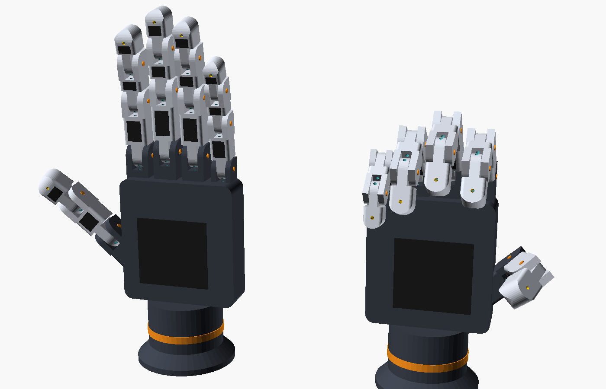
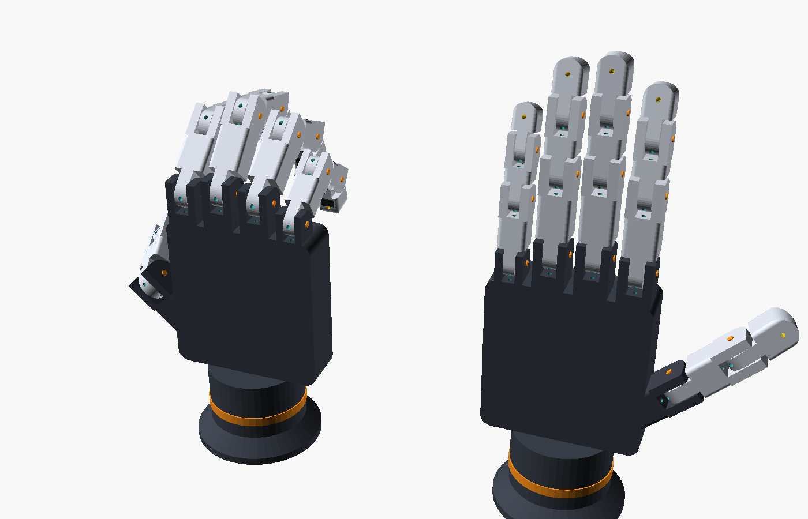
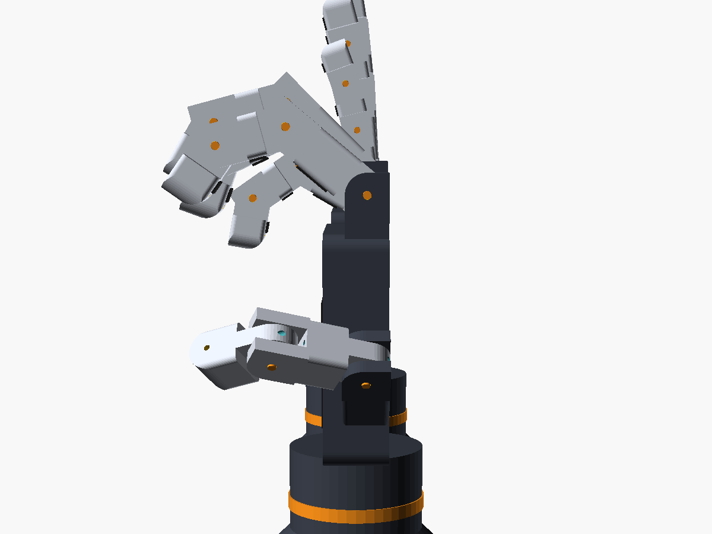
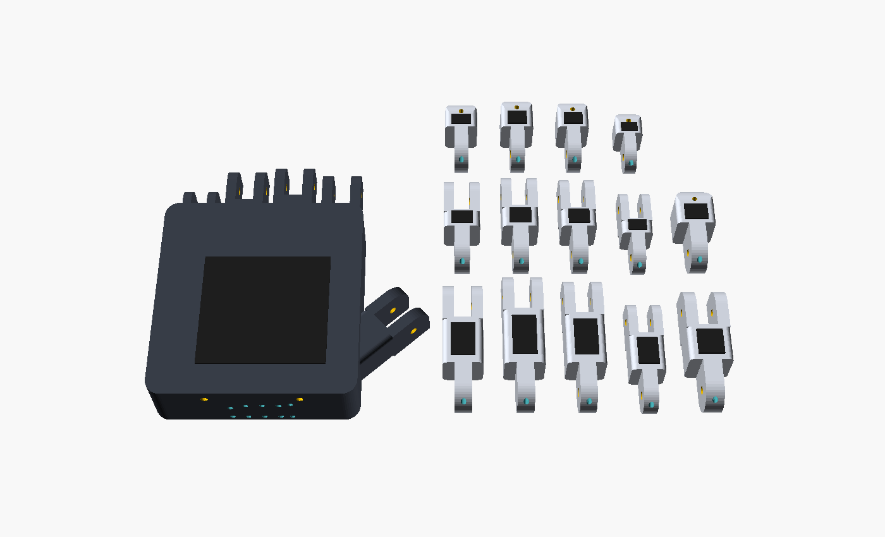
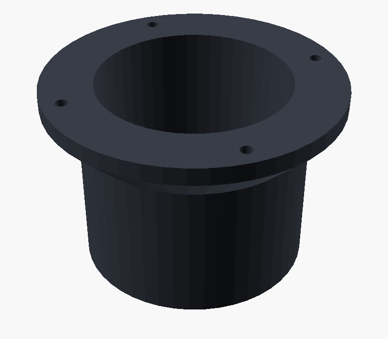

# Open Hands

A pair of 3D-printable, tendon-driven robotic hands modeled in [OpenSCAD](https://openscad.org/).
Each finger is made of printed segments joined by pin hinges. A string in a channel on the palm side curls the finger, and an elastic cord on the back pulls it straight again.



| Back | Side |
| --- | --- |
|  |  |

## Prompts

This project was generated with Claude Code from these prompts, in order:

1. > Can you generate an openscad file for some robotic hands? Render the image and verify that it looks correct.
2. > Save rendered images and make a readme with a prompt and how to set this up.
3. > put images in readme also, can you make this 3d printable. update original prompt too.

## What's in the model

[`robotic_hands.scad`](robotic_hands.scad) builds each hand from three kinds of printed part:

| Part | Count per hand | Notes |
| --- | --- | --- |
| Palm | 1 | Includes the knuckle forks, the thumb mount, tendon channels and screw holes for the wrist. The left and right palms are mirror images. |
| Links | 14 | Three per finger plus two for the thumb. Each has a tongue at the base, a fork at the far end (or a fingertip), a grip pad and two string channels. The same set works for either hand. |
| Wrist | 1 | Hollow cuff. The palm screws onto its top plate and the tendons run down through the middle. It has four holes for mounting it to an arm or base. Fits either hand. |

**Joints:** each joint is a fork and tongue held together by a 3 mm pin. The back of each fork is square, which stops the finger bending backward. The palm side is rounded so the finger can curl. I checked the geometry for collisions:

- Fingers bend from 0° to about 100° at every joint.
- The thumb bends from 0° to 90°.
- Bending a finger backward by 20° makes it collide, so the stop works.

**Tendons:** each finger has two channels of 2.2 mm diameter. The one on the palm side carries the flexor string, and the one on the back carries the elastic return cord. Both run through every segment and the palm, then come out under the palm into the hollow wrist. In the fingertip, both channels end at an anchor hole where you tie them off.

## Printing





Ready-made STLs are in [`stl/`](stl/):

| File | Contents | Size (mm) |
| --- | --- | --- |
| `plate_right.stl` / `plate_left.stl` | Palm and all 14 links on one plate | 224 × 146 × 25 / 226 × 146 × 25 |
| `palm_right.stl` / `palm_left.stl` | Palm only | 107 × 111 × 25 |
| `links.stl` | All 14 links (same for either hand) | 112 × 146 × 18 |
| `wrist.stl` | Wrist cuff (same for either hand) | 68 × 68 × 44 |

If your bed is smaller than about 230 mm, print the palm and the links as separate jobs instead of using a plate file.

Every part is already positioned for printing:

- The palm and links lie flat on their backs.
- The wrist is upside down, with its top plate on the bed.

The parts are designed to print without supports.

Suggested settings: PLA or PETG, 0.2 mm layers, 3 or more walls (perimeters), 20–30% infill.

### Hardware (per hand)

| Item | Qty | Notes |
| --- | --- | --- |
| 3 mm pins | 14 | Steel or brass rod, cut M3 screws, or 3 mm filament. Lengths: index and middle 16/16/15, ring 16/16/14, pinky 14/14/13, thumb 17/17 (palm joint first). The model prints these to the console when it renders. |
| M3 × 12 screws | 2 | Fix the palm to the wrist. Insert them from inside the wrist tube. |
| M3 self-tapping screws | 4 | Optional: mount the wrist to an arm or base. |
| Braided line, about 0.8 mm | 5 × 40 cm | Flexor tendons. Fishing line or kite line works. |
| Elastic cord, about 1 mm | 5 × 40 cm | Return cords. |

### Assembly

1. **Clean the holes.** Clear the pin holes with a 3 mm drill bit if they're tight. The tongue holes are 3.5 mm, so the joints turn freely, and the fork holes are 3.2 mm, so they grip the pin.
2. **Pin the joints.** Pin each finger together from the palm outward: palm fork → link 1 → link 2 → fingertip. Pin the thumb onto the angled mount on the side of the palm.
3. **Thread the tendons.** From the wrist end, feed a flexor string up each palm-side channel to the fingertip anchor hole, and tie it off. Do the same with elastic cord in the back channels.
4. **Attach the wrist.** Screw the palm onto the wrist with the two M3 × 12 screws, driving them from inside the tube.
5. **Drive the fingers.** Pull the strings below the wrist to curl the fingers. You can tie them to rings or attach them to servo horns.

These parts haven't been test-printed yet. The geometry has been checked: every part is watertight, sits flat on the bed, and is free of collisions across each joint's range of motion. Expect to tune the clearances for your printer (see [Customizing](#customizing)).

## Setup

### 1. Install OpenSCAD

On macOS, use Homebrew:

```sh
brew install --cask openscad@snapshot
```

> **Apple Silicon note:** the stable OpenSCAD 2021.01 release is built only for
> Intel Macs. Without Rosetta it fails with `bad CPU type in executable`.
> The snapshot build runs natively on arm64 and on Intel, and includes the
> much faster Manifold geometry engine (the `--backend=manifold` option) used below.

On other platforms, download a build from <https://openscad.org/downloads.html>.

Check that it's installed:

```sh
openscad --version
```

### 2. Rebuild the STLs and images

```sh
./build.sh
```

This regenerates everything in `stl/` and `images/`. To export a single part:

```sh
openscad --backend=manifold -D 'part="palm"' -D 'hand="left"' -o palm_left.stl robotic_hands.scad
```

`part` can be `assembly` (the default, both hands posed), `plate`, `palm`, `links` or `wrist`.
`hand` can be `right` or `left`, and affects only `palm` and `plate`.

To edit the model interactively, open `robotic_hands.scad` in the OpenSCAD app. Press F5 to preview or F6 to do a full render.

## Customizing

These parameters are at the top of `robotic_hands.scad`.

**Print fit:**

| Parameter | Default | Meaning |
| --- | --- | --- |
| `c` | 1.0 | Gap between a tongue and the base of its fork, measured outward from the pin |
| `sc` | 0.4 | Gap between each side of a tongue and its fork prongs. Increase it if the joints bind. |
| `pin_d` / `pin_free_d` | 3.2 / 3.5 | Pin hole diameters through the forks and through the tongues |
| `chan_d` | 2.2 | Tendon channel diameter |
| `screw_d` | 2.8 | Pilot hole diameter for M3 self-tapping screws |

**Shape:**

| Parameter | Meaning |
| --- | --- |
| `palm_w`, `palm_h`, `palm_t` | Palm width, height and thickness (mm) |
| `fingers` | One entry per finger: `[x, knuckle raise, base width, thickness, [segment lengths]]`. Each segment length must be at least the finger thickness plus about 6 mm. |
| `wtaper` | How much narrower each segment is than the one before it |
| `thumb_w`, `thumb_t`, `thumb_len`, `thumb_ang` | Thumb width, thickness, segment lengths and splay angle |

**Poses:** the assembly view's poses are at the bottom of the file. Each finger takes three joint angles in degrees, and positive angles curl toward the palm:

```openscad
open_pose = [[ 5,  5,  5], [ 3,  3,  3], [ 5,  5,  5], [ 8,  6,  6]];
grip_pose = [[50, 55, 40], [45, 60, 45], [55, 60, 45], [60, 65, 45]];

hand_assembly(grip_pose, [70, 45]);   // second argument: thumb joint angles
```
